# Robot Niko

A life-size, 3D-printed humanoid assistant in the InMoov style, built in
2022 at the FabLab of the Deputy Commissioner's Office, Cumilla. It talks,
moves its head, eyes, jaw, arms and fingers, and knows people by their
faces. It runs Python on a Raspberry Pi.

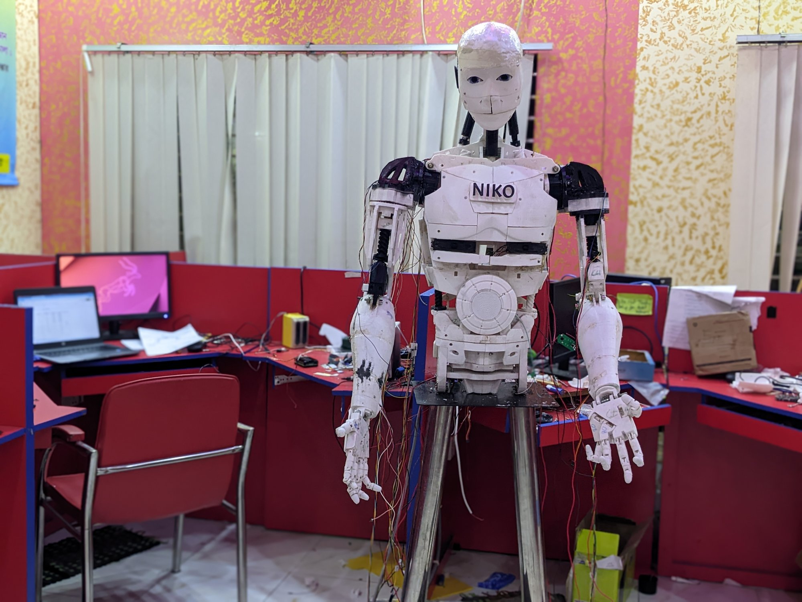

**Videos:**

- [The head turning and the mouth moving](docs/media/robot-niko-2022-11-03-head-test.mp4)
  (15 s, November 2022)
- [Niko's model in Blender](docs/media/robot-niko-2022-08-07-virtual-model.mp4)
  (17 s, August 2022)

## What it does

- **Talks.** It wakes to "Hey Niko", a Porcupine wake word, and holds
  spoken conversations. It knows 51 questions, most of them in several
  phrasings, from [`config/conversation.yaml`](config/conversation.yaml),
  and speaks their answers itself; an online assistant answers the rest.
  Its jaw moves as it speaks.
- **Moves.** 27 servos turn its head and eyes, and move its jaw,
  shoulders, arms, wrists and fingers ([servo map](#servo-map)).
- **Knows faces.** [`src/vision/recognise_faces.py`](src/vision/recognise_faces.py)
  watches the camera and recognises the people it was trained on, with
  `face_recognition` and a KNN classifier. [`src/face_greeting.py`](src/face_greeting.py)
  then greets each one by name and shakes their hand.
- **Gives a speech.** [`src/launch_speech.py`](src/launch_speech.py) holds
  the speech written for its launch, in seven parts.
- **Starts by itself.** A systemd service starts it at boot.

**Written but switched off:** ten voice commands for gestures and for
driving, such as "hands up", "handshake" and "go forward"
([`config/conversation-with-actions.yaml`](config/conversation-with-actions.yaml),
[`src/movement/mobility.py`](src/movement/mobility.py)). The finished
robot's stand sits on a wheeled base, but the main program doesn't load these
commands.

**Planned in 2022, not built:** speech in Bangla, ROS, mapping, and emotion
and gender detection.

## The design

[InMoov](https://inmoov.fr/) is the open-source, life-size robot of Gaël
Langevin, a French sculptor and designer. He began it in 2012 as a
prosthetic hand, and its parts print on any home 3D printer with a
12 × 12 × 12 cm bed. Niko is InMoov's head, torso, arms and hands on a
stand, run by a Raspberry Pi with its own Python code instead of InMoov's
usual Arduino and MyRobotLab.

| | | |
|---|---|---|
| 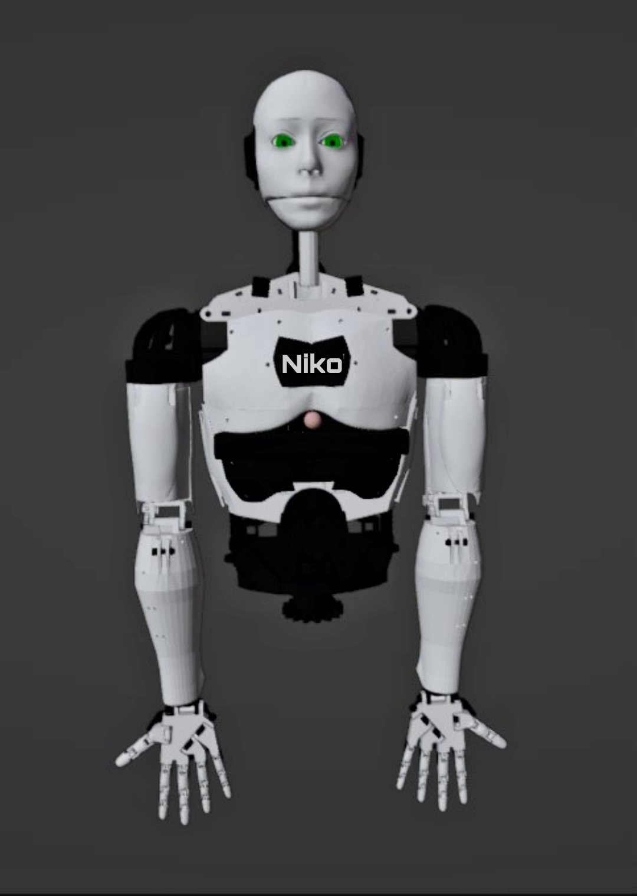 | 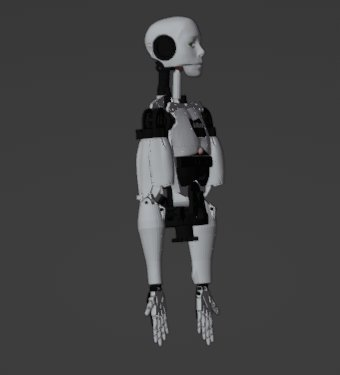 | 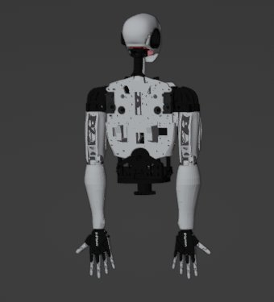 |

Niko's 3D model in August 2022, made from InMoov's parts in Blender, its name
on the chest. A [video of the model](docs/media/robot-niko-2022-08-07-virtual-model.mp4)
(17 s) shows its joints posed on the timeline:

<a href="docs/media/robot-niko-2022-08-07-virtual-model.mp4">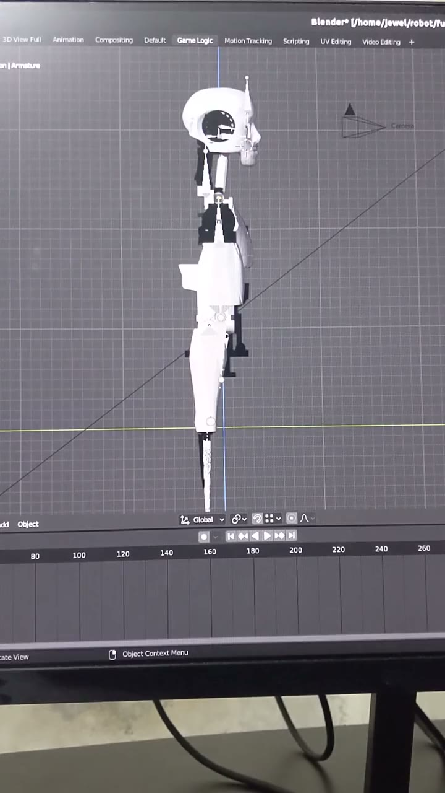</a>

## The build

November 2022, in date order.

| | | |
|---|---|---|
| 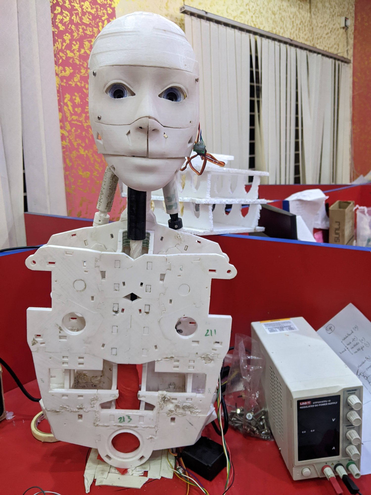<br>**11-02:** the head on its frame, its eyes in | 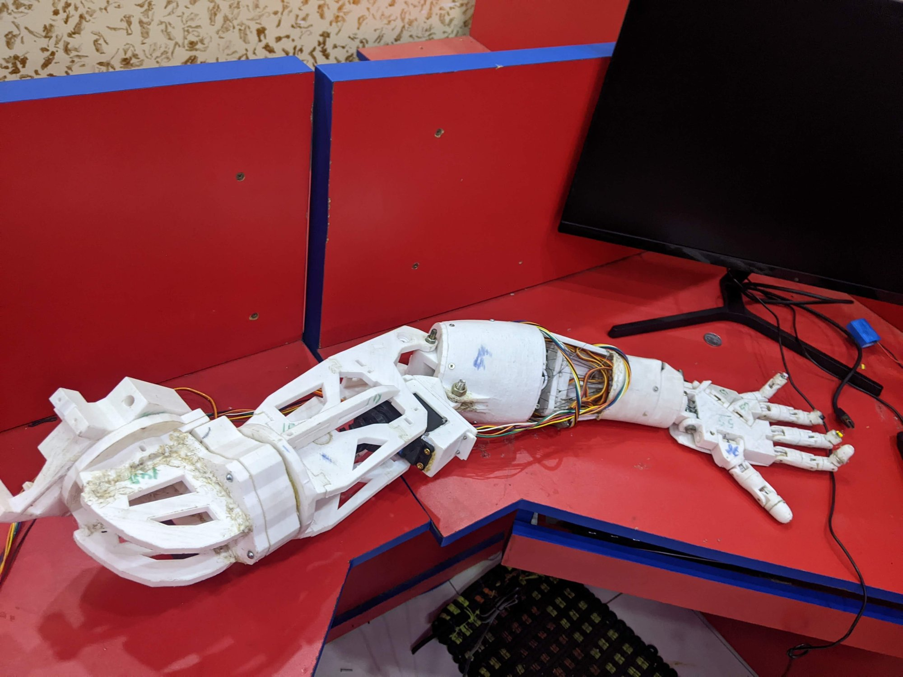<br>**11-02:** one arm and hand, printed and wired | <a href="docs/media/robot-niko-2022-11-03-head-test.mp4"></a><br>**11-03:** a head test: it turns, and the mouth moves ([video](docs/media/robot-niko-2022-11-03-head-test.mp4), 15 s) |
| 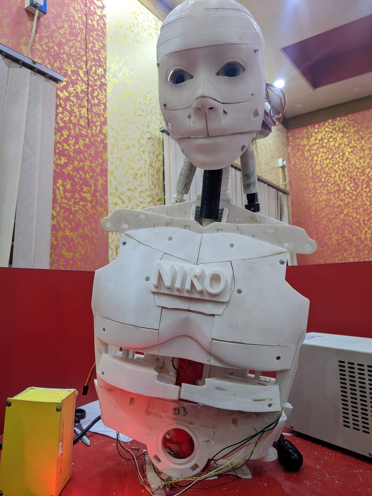<br>**11-08:** the head on the chest, its name printed on it | 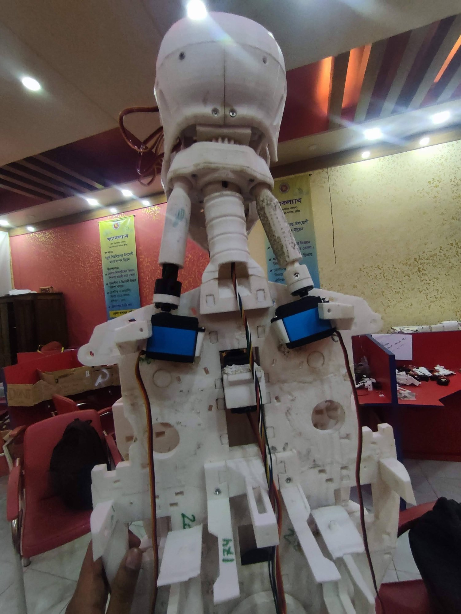<br>**11-17:** from behind: the neck, and two servos at the top of the torso | <br>**11-23:** the head on the assembled torso |
| 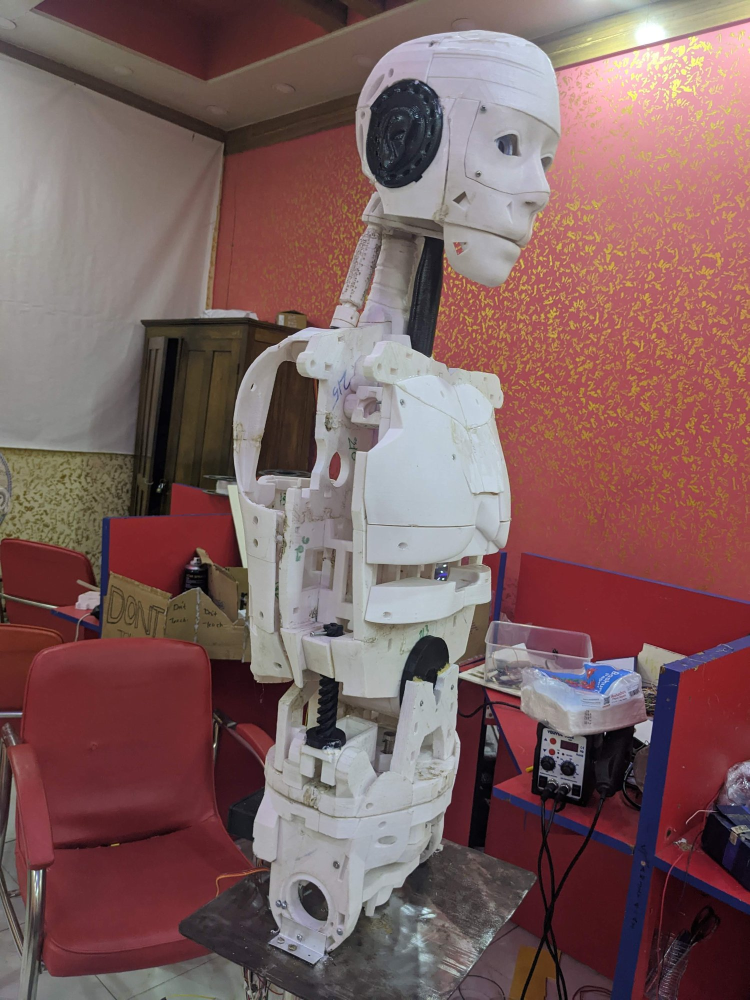<br>**11-23:** from the side: the worm gear in its waist | 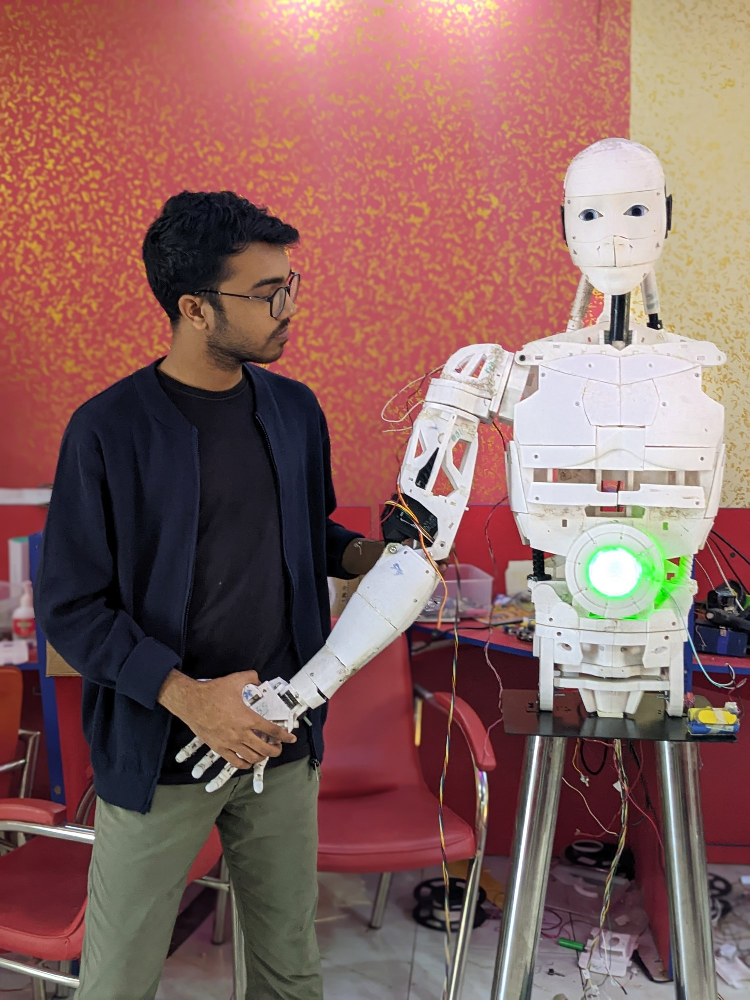<br>**11-24:** me holding the first arm in place at the shoulder | <br>**11-27:** one arm fitted, and the name on the chest |
| 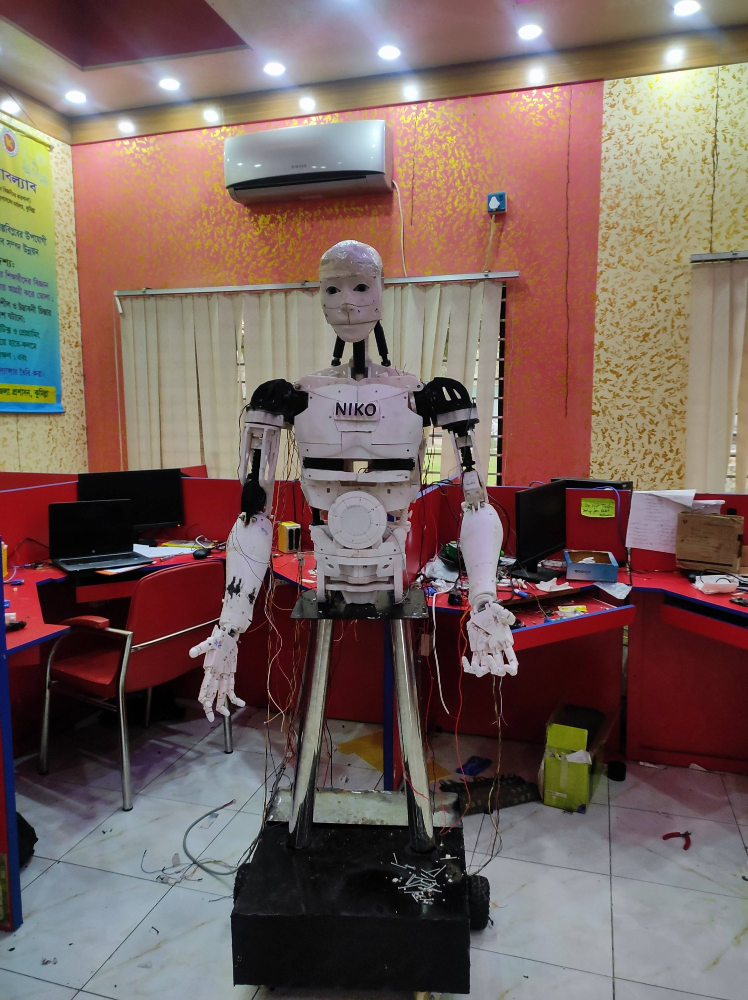<br>**11-29:** finished, both arms on, its stand on a wheeled base | <br>**11-29:** me with Niko and its green chest light | |

## How it works

| | |
|---|---|
| Body | The InMoov design: a 3D-printed head, torso, arms and hands, on a metal stand over a wheeled base |
| Servos | 27, on two PCA9685 boards (I2C addresses 0x40 and 0x41), driven by [`src/move.py`](src/move.py) and [`src/movement/`](src/movement). Their channels and starting angles are in [`config/servo-configuration.yaml`](config/servo-configuration.yaml), and in the [servo map](#servo-map) below |
| Voice | A Porcupine wake word, and an online assistant for listening and open questions. Niko's own answers are spoken by ttsmp3.com in a headless Chromium ([`src/talk.py`](src/talk.py)); the greetings and the speech use gTTS ([`src/talk_gtts.py`](src/talk_gtts.py)) |
| Jaw | It moves while a signal on GPIO 18 says Niko is speaking ([`src/move.py`](src/move.py)) |
| Vision | A camera; `face_recognition` with a KNN classifier, trained on the photos in [`data/faces/`](data/faces). A separate script turns the head toward a face it sees, with OpenCV ([`src/vision/`](src/vision)) |
| Lights | Two status lights, for listening and speaking ([`src/indicator.py`](src/indicator.py)) |
| System | Python on a Raspberry Pi, started at boot by a systemd service ([`systemd/robot.service`](systemd/robot.service)) |

### Servo map

Each servo's channel and starting angle, as set in
[`config/servo-configuration.yaml`](config/servo-configuration.yaml), the
file [`src/move.py`](src/move.py) loads at start; the moves in
[`src/movement/`](src/movement) use the same channels. Channels 0–15 are on
the first PCA9685 board (0x40), and 16–26 are the second board's (0x41)
channels 0–10. Angles are in degrees, from 0 to 180.

**Head**

| Servo | Channel | Starting angle |
|---|--:|--:|
| Head rotation | 11 | 90° |
| Neck | 12 | 30° |
| Neck, left | 14 | 85° |
| Neck, right | 13 | 100° |
| Eyes, side to side | 10 | 90° |
| Eyes, up and down | 26 | 120° |
| Jaw | 15 | 70° |

**Arms and hands**

| Servo | Right channel | Right start | Left channel | Left start |
|---|--:|--:|--:|--:|
| Shoulder | 0 | 90° | 16 | 90° |
| Omoplate (shoulder blade) | 1 | 90° | 17 | 100° |
| Arm rotation | 2 | 90° | 18 | 45° |
| Bicep | 3 | 90° | 19 | 90° |
| Wrist | 4 | 90° | 20 | 90° |
| Thumb | 5 | 0° | 21 | 0° |
| Index finger | 6 | 0° | 22 | 0° |
| Middle finger | 7 | 0° | 23 | 0° |
| Ring finger | 8 | 0° | 24 | 0° |
| Little finger | 9 | 0° | 25 | 0° |

## Repository layout

| Folder | Holds |
|---|---|
| [`src/`](src) | The programs: [`main.py`](src/main.py), the voice that runs at boot, and [`launch_speech.py`](src/launch_speech.py), with the modules they share |
| [`src/movement/`](src/movement) | The moves of the head, eyes, arms, hands and wheels |
| [`src/vision/`](src/vision) | Recognising faces, turning the head toward one, and taking face photos for training |
| [`config/`](config) | What Niko says, and its servos' channels and starting angles |
| [`assets/`](assets) | Its sounds, the "Hey Niko" wake word and the face models |
| [`data/faces/`](data/faces) | The face photos the recogniser was trained on |
| [`scripts/`](scripts) | The installers, the list of system packages and the USB sound card setup |
| [`systemd/`](systemd) | The service that starts Niko at boot |
| [`docs/`](docs) | The photos and videos on this page |
| [`experiments/`](experiments) | The first tests from 2022: listening, speaking, servos and motors, and an unused Arduino link |

## My part

Niko was built by Quanta Robotics, the robotics team I co-founded at
Comilla University, at the FabLab of the Deputy Commissioner's Office in
Cumilla. The team was Shanjit Mondol, Anik Chakraborty
([@Anikcb](https://github.com/Anikcb)), Tousif Bin Parves
([@tousifo](https://github.com/tousifo)), Mahin Khan
([@mahinkhan1408](https://github.com/mahinkhan1408)) and me.

I worked on every part of Niko:

- **Body:** 3D-printing its parts and assembling it.
- **Servos:** tuning all 27. Each one's channel and starting angle are in
  [`config/servo-configuration.yaml`](config/servo-configuration.yaml) (the
  [servo map](#servo-map) above), and the angles of each move in
  [`src/movement/`](src/movement).
- **Motion:** planning its arm motions as timed sequences of servo angles,
  such as the handshake
  ([`src/movement/right_hand.py`](src/movement/right_hand.py)) and moves
  of both arms together ([`src/movement/hand.py`](src/movement/hand.py)).
- **Software:** leading its programming and writing most of its code. Most
  of the commits here are mine.

It stands on others' work:

- Its body is [InMoov](https://inmoov.fr/), Gaël Langevin's open-source,
  3D-printed robot.
- The voice program and the installers started from Shivasiddharth's
  [GassistPi](https://github.com/shivasiddharth/GassistPi).
- Face recognition started from the KNN camera example in Adam Geitgey's
  [face_recognition](https://github.com/ageitgey/face_recognition).
- [`scripts/install-service.sh`](scripts/install-service.sh) comes from
  Google's AIY projects, through GassistPi.

## Run it

Niko ran on Raspberry Pi OS with Python 3.7, in 2022. The assistant library
it listens with is no longer supported, and [`requirements.txt`](requirements.txt)
pins 2022's versions where they are known, so these steps record how it was
set up; they are not tested on today's Raspberry Pi OS.

On a Raspberry Pi wired to Niko's servo boards, camera, microphone and
speaker:

```bash
git clone https://github.com/jewel-nath/robot-niko ~/robot-niko
cd ~/robot-niko
./scripts/install.sh
```

The installer adds the system packages in
[`scripts/apt-packages.txt`](scripts/apt-packages.txt), makes a Python
environment in `~/robotEnv` from [`requirements.txt`](requirements.txt), and
signs in to the online assistant, which needs an OAuth client file at
`~/robotniko2.json`. Then:

1. Put your Picovoice access key in `~/robot-niko.env`, as
   `PICOVOICE_ACCESS_KEY=<your key>`. The key stays out of the repository.
2. In [`systemd/robot.service`](systemd/robot.service), change Niko's
   project and device model IDs to yours.
3. Install the service and start it:

   ```bash
   sudo ./scripts/install-service.sh
   sudo systemctl enable --now robot.service
   ```

For a USB sound card, run `sudo ./scripts/audio/install-usb-sound-card.sh`
first.

To recognise faces, run `python src/vision/recognise_faces.py` with a camera
attached. To add a person, run
`python src/vision/capture_faces.py "<name>"`: it takes their face photos
for training into `data/faces/`, and needs dlib's
`shape_predictor_68_face_landmarks.dat` in `assets/models/`.

## Licence

The code is under the MIT licence: see [LICENSE](LICENSE). The files that
came from other projects keep those projects' notices at the top.
face_recognition is MIT, and Google's service installer is Apache 2.0.
GassistPi's licence is MIT with two conditions: its code may not be used
for competitions or submitted for assessments without its owner's
permission.
Niko's body, and the renders of its model, follow InMoov's licence,
[CC BY-NC 3.0](https://creativecommons.org/licenses/by-nc/3.0/).
