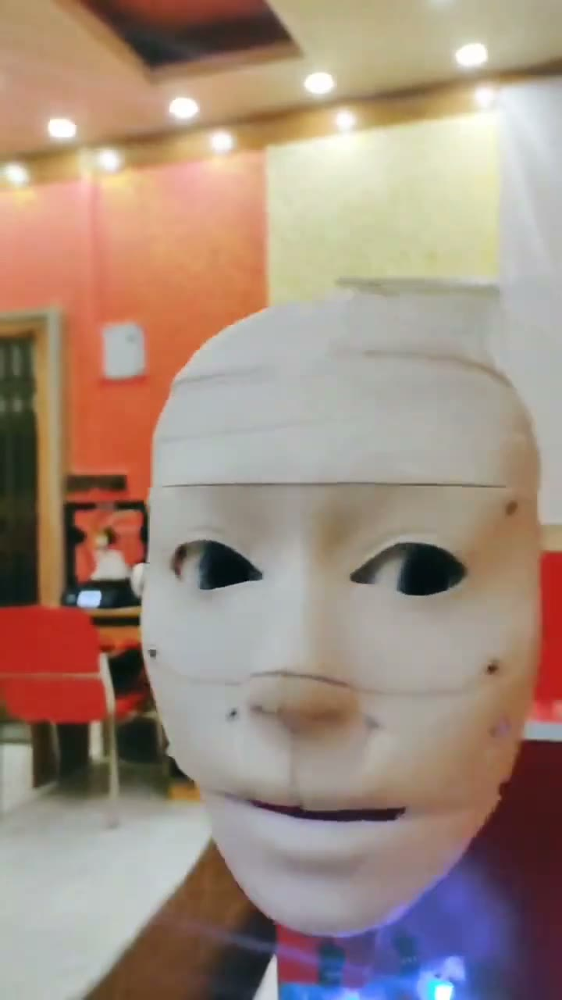
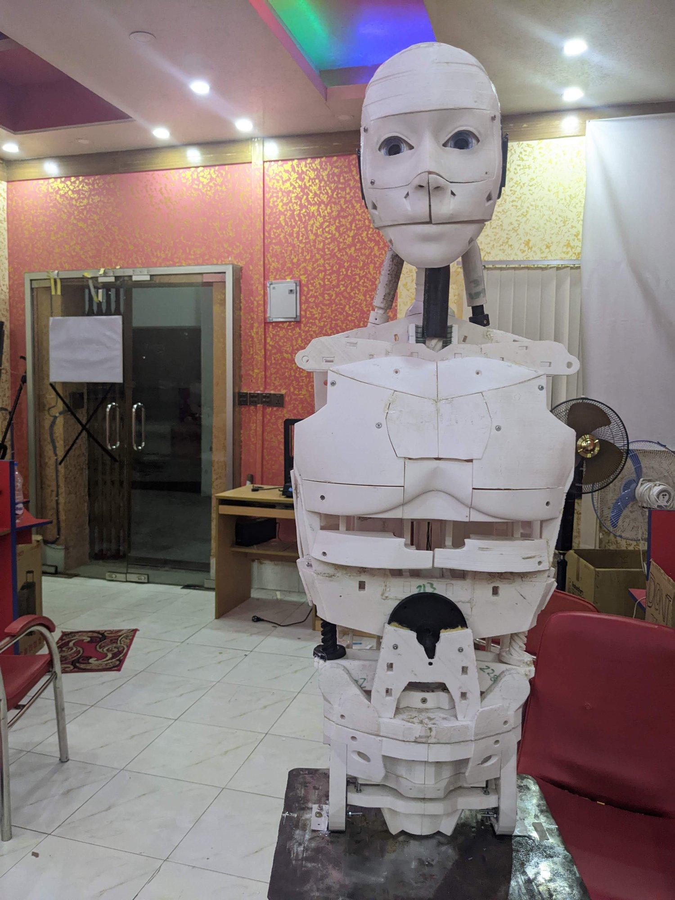
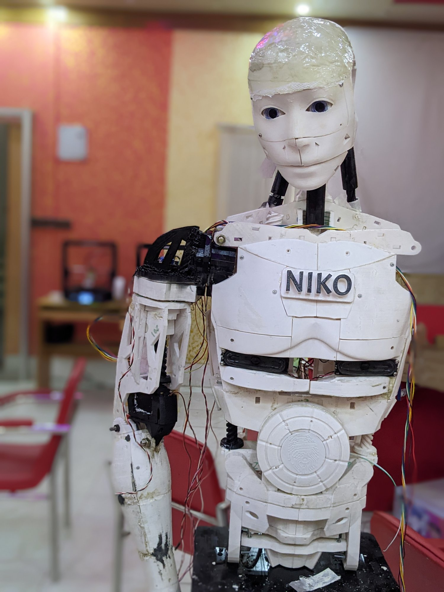
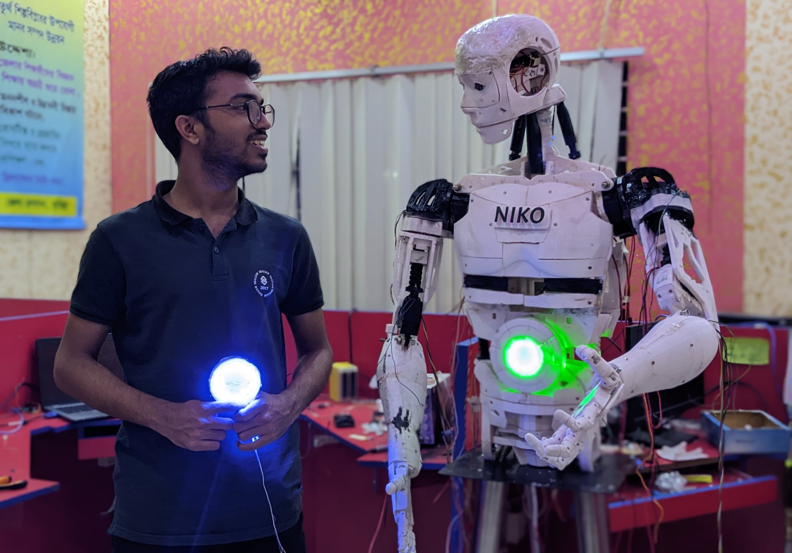
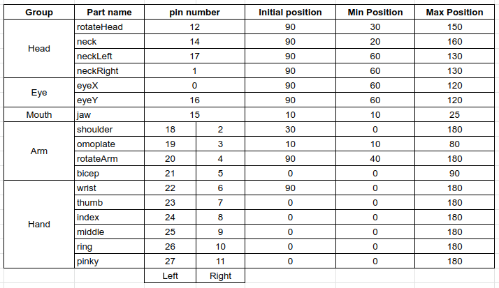

# Robot Niko

A life-size, 3D-printed humanoid assistant in the InMoov style, built in
2022 at the FabLab of the Deputy Commissioner's Office, Cumilla. It talks,
moves its head, eyes, jaw, arms and fingers, and knows people by their
faces. It runs Python on a Raspberry Pi.


**Videos:** [the head turning and the mouth moving](media/robot-niko-2022-11-03-head-test.mp4)
(15 s) · [Niko's model in Blender](media/robot-niko-2022-08-07-virtual-model.mp4) (17 s)

## What it does

- **Talks.** It wakes to "Hey Niko", a Porcupine wake word, and holds
  spoken conversations: questions it knows are answered from
  [`src/conversation.yaml`](src/conversation.yaml), and the rest go to an
  online assistant. Its jaw moves as it speaks.
- **Moves.** 27 servos turn its head and eyes, and move its jaw,
  shoulders, arms, wrists and fingers.
- **Knows faces.** It recognises the people it was trained on, with
  `face_recognition` and a KNN classifier, and greets them with a
  handshake ([`src/faceRecognition.py`](src/faceRecognition.py)).
- **Gives a speech.** A scripted speech, with head and arm gestures
  ([`src/special-speech.py`](src/special-speech.py)).
- **Starts by itself** at boot, as a systemd service.

**Written but switched off:** voice commands for gestures and for driving
on wheels ([`src/conversation1.yaml`](src/conversation1.yaml),
[`src/movement/mobility.py`](src/movement/mobility.py)). The final main
program turns them off, and the finished robot stands on a fixed stand.

**Planned in 2022, not built:** speech in Bangla, ROS, mapping, and
emotion and gender detection.

## The build

| | |
|---|---|
| <a href="media/robot-niko-2022-08-07-virtual-model.mp4"></a> | **2022-08:** Niko's model in Blender, its joints posed on the timeline ([video](media/robot-niko-2022-08-07-virtual-model.mp4), 17 s) |
|  | **2022-11-02:** the head on its frame, its eyes in |
|  | **2022-11-02:** one arm and hand, printed and wired |
| <a href="media/robot-niko-2022-11-03-head-test.mp4"></a> | **2022-11-03:** a head test: it turns, and the mouth moves ([video](media/robot-niko-2022-11-03-head-test.mp4), 15 s) |
|  | **2022-11-23:** the head on the assembled torso |
|  | **2022-11-27:** one arm fitted, and the name on the chest |
|  | **2022-11-29:** finished: me with Niko and its green chest light |

## How it works

| | |
|---|---|
| Body | The InMoov design: a 3D-printed head, torso, arms and hands, on a metal stand |
| Servos | 27, on two PCA9685 boards (I2C addresses 0x40 and 0x41), driven by [`src/movement/`](src/movement) |
| Voice | A Porcupine wake word, PyAudio, gTTS and pyttsx3, and an online assistant for open questions |
| Vision | A camera; OpenCV face detection, and `face_recognition` with a KNN classifier ([`src/Face-Recognition/`](src/Face-Recognition)) |
| Arduino | Commands over USB serial ([`src/arduino.py`](src/arduino.py)) |
| System | Python on a Raspberry Pi, a systemd service ([`systemd/robot.service`](systemd/robot.service)), and installers in [`scripts/`](scripts) |



Each servo's channel, starting position and range. Where a part has two
channels, they are its left and right.

## My part

Niko was built by the team at Quanta Robotics, the robotics team I
co-founded at Comilla University, at the FabLab of the Deputy
Commissioner's Office in Cumilla. I was its programmer: most of the commits here are
mine, with code from [@tousifo](https://github.com/tousifo),
[@mahinkhan1408](https://github.com/mahinkhan1408) and
[@Anikcb](https://github.com/Anikcb). Its body follows
[InMoov](https://inmoov.fr/), Gaël Langevin's open-source, 3D-printed
robot.

## Run it

On a Raspberry Pi wired to Niko's servo boards, camera, microphone and
speaker. The code expects the repository at `~/Robot-Niko`:

```bash
git clone https://github.com/jewel-nath/robot-niko ~/Robot-Niko
cd ~/Robot-Niko/scripts
./robot-installer.sh
```

The installer sets up a Python environment in `~/robotEnv`, installs the
requirements in [`Requirements/`](Requirements), and signs in to the
online assistant, which needs an OAuth client file at
`/home/pi/robotniko2.json`. Then:

1. Put your Picovoice access key in `/home/pi/robot-niko.env`, as
   `PICOVOICE_ACCESS_KEY=<your key>`. The key stays out of the repository.
2. Install the service and start it:

   ```bash
   sudo ./service-installer.sh
   sudo systemctl enable --now robot.service
   ```

## Licence

MIT: see [LICENSE](LICENSE).
